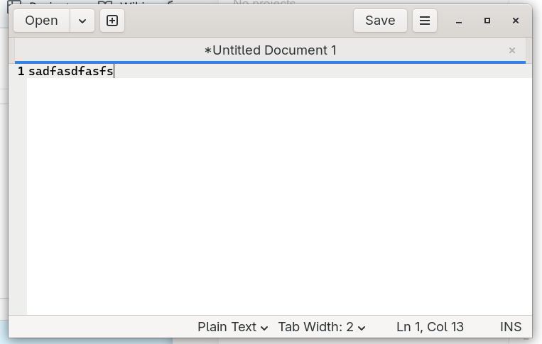

# gedit+



An unofficial customization of gedit 50.0 that preserves untitled documents when closing windows or quitting. This is a local development project, not an official GNOME or gedit release. Source and source-complete packages are published under GPL-3.0-or-later.

## Features

- Restore untitled text, tab order, cursor positions, active tabs, and multiple windows after an orderly close, including across reboot.
- Keep normal Save/Discard/Cancel confirmation for modified named files. Cancel leaves the window and tabs open.
- Keep a document open and report an error if its draft cannot be stored.
- Remove the stored draft after successfully saving it as a named file.
- Keep normal confirmation when explicitly closing an individual untitled tab.
- Enable or disable draft preservation under Preferences → Editor.
- Show the tab bar for a single document; omit the document title from the header bar.
- Use a custom notepad icon with a blue plus and the launcher name **gedit+**.

Drafts are written on orderly window close or Quit; this is not continuous autosave or crash recovery. Existing drafts can still restore when preservation is disabled. Draft text is stored locally, unencrypted, under `$XDG_DATA_HOME/gedit/drafts-v1` (normally `~/.local/share/gedit/drafts-v1`), with private directory and file permissions.

## Build and try

See [BUILDING.md](BUILDING.md) for dependencies. From this directory:

```sh
./build.sh
./run-tests.sh
python3 install-user.py
```

The installer installs per-user launchers and icons. It preserves existing gedit preferences and retains the stock system binary. This development build shares gedit's application ID, settings, and desktop entry, so it replaces the normal gedit launcher for the current user. Do not treat it as an independent side-by-side package. The single-tab display preference was enabled for the original local installation; other installations can select “Always” in the existing tab-bar preference.

Run `python3 rollback-user.py` to restore previous launchers; drafts and preferences remain. Build outputs, local preferences, draft fixtures, logs, and launcher backups are excluded from Git.

## Directory browser — release 50.0-3

Press **F9** or use View → Side Panel to show or hide the left sidebar. The × button at the top right of the sidebar hides it; F9 reopens it. File Browser is the default view; its selector switches between Documents and File Browser and remembers your selection. Enable File Browser under Preferences → Plugins if it is disabled. Choose a directory using the browser location controls; double-click a folder to replace the sidebar view with that folder’s contents, or double-click a file to open it for editing. Use the disclosure arrows to expand or collapse folders without changing the workspace. The browser provides filters for hidden and binary files.

Use **Open ▾ → Workspace** to open a directory-only selector. Single-click a folder and click **Select** to replace the File Browser sidebar with that directory’s file tree. The selector starts at the current workspace (or your home folder). Cancel leaves the workspace unchanged; selecting a folder enables File Browser when needed.

## Source and licensing

The repository contains a patch against a pinned upstream release, build/test/install scripts, and artwork. `build.sh` checks the source revision and refuses incompatible changes. See [UPSTREAM.md](UPSTREAM.md) and [NOTICE](NOTICE).

The combined customization is distributed under **GPL-3.0-or-later**; see [LICENSE](LICENSE). Original upstream files retain their own copyright and license notices. Additional license texts are in `LICENSES/`. Redistribution of binaries must include compliant access to the complete corresponding source, including the pinned libgd source and build scripts.

See [PACKAGING.md](PACKAGING.md) for Fedora RPM and Ubuntu 26.04 DEB installation and rebuild instructions. macOS builds remain unverified.

## Repositories

Source and packages: [GitHub](https://github.com/greenfinch628/gedit-) and
[Scopuli Gitea](http://scopuli:3000/scopuli/gedit-).
The repository slug is `gedit-`; the application and package remain `gedit+`
and `gedit-plus`, respectively.

## Binary packages

Fedora 44 RPM and Ubuntu 26.04 DEB packages, checksums, and complete
corresponding sources are available in [packages/](packages/README.md).
The packages use `gedit-plus` as their command and a private `/opt/gedit-plus`
prefix. They still share preferences and draft storage with stock gedit.
